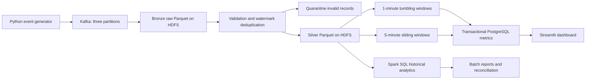

# CS404 Real-Time E-Commerce Analytics Platform

A course project that processes real historical shopping events and synthetic test events using Apache Kafka, PySpark,
Spark SQL, Spark Structured Streaming, HDFS, PostgreSQL, and a Streamlit dashboard.
No machine learning training is required.

**Real dataset replay:** [setup, attribution and metric definitions](docs/REAL_DATA.md).
The dashboard can replay a one-million-event prefix of the official REES46 October
2019 dataset with pause/resume, adjustable speed and persistent progress. Real and
synthetic results are separated; source purchase prices are not labelled as INR or
complete order revenue. Downloaded data stays local and is not committed to GitHub.

**Baseline pipeline validation:** the complete [validation run passed](https://github.com/Owaish0/BDA---Ecommerce-Data-Processing/actions/runs/37045071846):
all 15 tests, 1,585 accepted events across recovery/duplicate/invalid scenarios, exact batch
reconciliation, historical reports, actual browser recording, and one/two-worker benchmarks.
The local Windows live dashboard is also verified. See [measured results](docs/RESULTS.md)
and [progress](docs/PROGRESS.md).

The integrated dashboard controls were verified locally on 14 October 2026:
18 regression tests passed, and live checks covered pause/resume, speed changes,
all four event scenarios, and successful historical-report publication.

## Architecture



The Spark standalone cluster uses a master and worker with multiple executor tasks.
An optional second worker demonstrates scaling. Bronze preserves the Kafka payload,
partition, offset, and ingestion timestamp. Silver stores validated events with
duplicate suppression. Separate queries keep deduplication and aggregation state isolated.

## Run from a fresh clone (Windows or macOS)

Install Git and Docker Desktop first. Open Docker Desktop and wait until its engine
is running. On Windows use Linux containers with the WSL 2 backend. Allocate about
12 GB RAM to Docker for the full stack and leave additional RAM for your operating
system. First builds need internet access and download Spark, Hadoop and packages;
allow several minutes and enough disk space for images and growing event storage.
Python, Java, Kafka and Spark do not need to be installed on the host.

```sh
git clone https://github.com/Owaish0/BDA-Customer-Descriptive-Analysis.git
cd BDA-Customer-Descriptive-Analysis
```

**Windows — PowerShell:**

```powershell
powershell -NoProfile -ExecutionPolicy Bypass -File .\scripts\bootstrap.ps1
```

This bypass applies only to that script process. If Docker cannot be found, add
`-DockerPath "C:\full\path\to\docker.exe"` to the command.

**macOS — Terminal (Intel or Apple Silicon):**

```sh
bash scripts/bootstrap.sh
```

Apple Silicon uses the included `compose.apple.yaml` x86 emulation profile. The
bootstrap records it in the ignored local `.env`, so subsequent Compose commands
use the same profile. Emulation may be slower than Intel/Windows x86. This profile
has been configuration-checked; execution on physical Mac hardware is not yet verified.

Both scripts create `.env` with a random database password, preserve existing
settings, create the local data folder, and build/start the services. Never commit
`.env`. Conservative resource defaults are in `.env.example`; optional tuning is
explained in [performance notes](docs/PERFORMANCE.md).

Open [the dashboard](http://localhost:8501), [Spark](http://localhost:8080), or
[HDFS](http://localhost:9870). Allow the first Spark batches to finish. New installs
start with synthetic events. In Overview choose **Synthetic data** to see their
metrics. Use **Replay controls** to pause/start and change speed. Historical and
real-replay views need the optional preparation below; a fresh clone has no saved
customer reports or previous machine's data.

### Add the real replay sample (optional)

From the project root after bootstrap, run this same command in PowerShell or macOS Terminal:

```sh
docker compose run --rm --no-deps --volume "./data:/app/data" producer python scripts/prepare_real_dataset.py --rows 1000000
```

This downloads a bounded prefix of the published October dataset. If the provider
requires login or changes its download endpoint, download the original October CSV
from Kaggle, put it in `data/2019-Oct.csv`, and append
`--csv data/2019-Oct.csv` to the preparation command. See [dataset details](docs/REAL_DATA.md).
Pause generation, choose **Real dataset replay**, click **Use selected source**,
then **Start events**. A completed sample can be replayed again using its existing
button. Raw data, reports and Docker volumes stay local and are deliberately excluded
from Git; the source preparation scripts are included.

Full historical Customer behaviour, Shopping journeys and Product performance
reports require a full-month import and Spark analysis, separately from replay.
Follow [historical analytics setup](docs/HISTORICAL_ANALYTICS.md); importing seven
months is optional and requires substantial time and storage.

### Stop, resume and troubleshoot

```sh
docker compose ps
docker compose logs --tail=80 streaming producer
docker compose down
docker compose up -d
```

`down` keeps stored data. Avoid `down -v` unless intentionally deleting it.
If ports 8501, 8080 or 9870 are occupied, stop the other instance or change the host
ports in your local Compose configuration. If HDFS initialization fails, inspect
`docker compose logs --tail=80 hdfs-init namenode datanode`, then rerun bootstrap.
On Windows, confirm WSL 2 and hardware virtualization are available; on Apple Silicon,
confirm Docker Desktop supports x86 emulation. Machines with limited RAM can fail
or process slowly. Database results and event generation are independent of the
browser; closing a tab does not stop the containers.

## Operation

The main dashboard includes Start/Pause, target speed (1–2,000 events/second), and a
flash sale of 10,000 purchase records. Data-quality controls send 50 duplicate pairs,
100 invalid records, or 100 records timestamped three minutes in the past. Each finite
action works even when continuous generation is paused. Pause does not cancel an
already-running finite action. Action activity records queued, running, completed,
and failed outcomes; completion means Kafka acknowledged delivery, not that Spark has
finished processing. Recent events are a bounded sample of acknowledged sends.

Historical analysis runs from its existing results section through a dedicated Spark
worker, with a 15-minute limit. Only one finite event action and one batch action can
be active at a time. Interrupted actions are marked failed rather than automatically
replayed. Commands are stored in PostgreSQL; the dashboard has no Docker socket or
arbitrary shell execution. Speed is a target; delivery and processing rates depend on
machine capacity. Generator settings persist in PostgreSQL across restarts.

Quality counters shown by Spark describe the latest microbatch and may return to zero
in the next batch. Late-event acceptance depends on the actual watermark, not solely
on timestamp age. The Kafka-confirmed sends counter covers the managed producer only
and must not be equated with accepted unique events or the current sales horizon.

```sh
docker compose ps
docker compose logs --tail=100 streaming
docker compose logs --tail=100 producer
docker compose stop producer
docker compose run --rm producer python -m ecommerce.producer --rate 500 --count 10000 --scenario burst
docker compose start producer
docker compose restart streaming
docker compose --profile batch run --rm batch
docker compose --profile scale up -d spark-worker-2
```

To shut down while retaining data: `docker compose down`. Do not add `-v` unless you
intend to delete all Kafka, HDFS, PostgreSQL, and checkpoint data. Changing a query's
state schema requires a migration and a new checkpoint/query identity; do not casually
delete checkpoints or reuse old database epoch ledgers.

## Tests without Docker

```sh
python -m pip install -e '.[test]'
python -m unittest discover -s tests -v
ruff check .
python -m compileall -q src jobs dashboard scripts
```

PostgreSQL transaction tests require an isolated `TEST_DATABASE_URL`. They truncate
test metric tables; never point that variable at a live project database. GitHub CI
creates a disposable PostgreSQL service for these tests.

Generate a deterministic fixture without Kafka:

```sh
python -m ecommerce.producer --file data/fixture.jsonl --count 10000 --seed 404 --start-time 2026-01-01T10:00:00+00:00
```

See [requirements](docs/REQUIREMENTS.md), [reliability guarantees](docs/RELIABILITY.md),
[professor demo](docs/DEMO.md), and [validation plan](docs/VALIDATION.md).

## Team

| Member | Roll number |
|---|---|
| Harsh Jain | 2023BCS-023 |
| Md Rezaul | 2023BCS-035 |
| Owaish Ansari | 2023BCS-043 |
| Rajat Kumar | 2023BCS-053 |

## Customer analytics expansion

Historical customer analysis is separate from live Kafka replay. The dashboard now has dedicated Customer behaviour, Shopping journeys, Product performance and Analysis methods pages. Full-month imports and Spark summaries are being validated first on October 2019 before expanding to April 2020. See [historical import, metric definitions and validation](docs/HISTORICAL_ANALYTICS.md).
